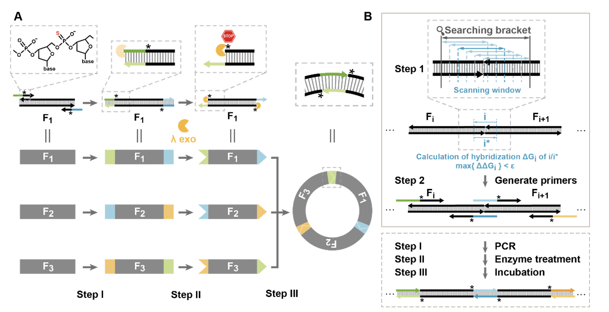

# modZN – automated overlap & primer designer for modAssembly

Python implementation of **modZN**, the design tool accompanying:

> **“Modular multi-fragment enzymatic assembly based on exonuclease resistant bases”**

modZN designs the overlapping sequences and PCR primers (with phosphorothioate `*` modifications) for **circular** and **linear** modAssembly, so that all sticky ends have similar hybridization free energy (ΔG). Use it through a **GUI** or a **command line** (e.g. on a server). A web version is also available at http://8.130.46.70/#/seq although it is less flexible than the command-line version.

**Quick start**

```
pip install -r requirements.txt
python modZN_linear.py -i example_input.txt -l 30 -m 3 -o primers.csv     # linear assembly
python modZN_circular.py -i example_input.txt -l 30 -m 3 -o primers.csv   # circular assembly
python GUI_for_modZN.py                                                # graphical interface
```

`example_input.txt` shows the input format: one fragment sequence per line, in assembly order. See [Usage](#-usage) for all options.

---

## 🧬 Background

Gibson or Golden Gate assembly suffers from sequence restrictions or falling efficiency as the fragment number grows. **modAssembly** assembles **up to 20 fragments** in one pot by combining:

- PCR with **phosphorothioate-modified primers**,
- λ-exonuclease digestion, which leaves **defined sticky ends**, and
- one-pot **self-assembly** through the complementary overhangs.

**modZN** automates the design of the overlaps and primers.


The **Workflow** of modAssembly. (A) Three-fragment **modAssembly**: fragment amplification with modified primers (step I), lambda exonuclease digestion (step II) and fragment hybridization (step III). Asterisks denote phosphorothioate modifications. Green, blue and orange segments are the overlaps F3/F1, F1/F2 and F2/F3. (B) The primer design of **modZN**: search of overlaps with a ΔG requirement (step 1) and generation of full-length primers with modifications (step 2).

---

## ⚙️ What modZN Does

1. Scans the fragment ends for candidate overlaps.
2. Calculates ΔG with the nearest-neighbor model.
3. Balances ΔG across all junctions (**exact** search by default, or **greedy**).
4. Filters overlaps by **hairpin** formation (on by default).
5. Filters overlaps by **self-dimer** formation (on by default).
6. Filters pairs of overlaps by **cross-dimer** formation (on by default).
7. Generates the primers with `*` modifications; the forward primer is lengthened until its template-binding ΔG matches that of the reverse primer.
8. Calculates Tm with **primer3**.
9. Reports the result (GUI or terminal) and writes the primers to a `.csv` file.

### Overlap search methods

At each junction the overlap can be shifted by a few bases (the *search frame*, centred on the middle of the overlap). The default is 8 bases; if needed you can increase it with `--search-frame-length` for more room. modZN picks one position per junction so that the ΔG difference between the strongest and weakest overlap is as small as possible.

- **`exact` (default)** – guaranteed global optimum within the search frame. The ΔG values of all candidate overlaps are sorted, and a window `[low, high]` slides along them (a two-pointer sweep: both ends only move forward) to find the narrowest range in which every junction still has a usable overlap. It first finds the best design while ignoring conflicts between overlaps (e.g. cross dimers) and checks whether that design is conflict-free; only if it is not, it examines the windows more carefully with arc-consistency propagation and backtracking. Ties are broken deterministically (narrowest window, then lowest ΔG, then the most centred overlaps), so the same input always gives the same design.
- **`greedy`** – a hill-climbing search that repeatedly adjusts the weakest and the strongest overlap. It usually reaches the same optimal ΔΔG as `exact`. ΔΔG is set by the strongest and weakest overlaps, so the remaining overlaps in between may sit at different positions. With a long search frame or many fragments it can take impractically long; then use `exact`.

### Hairpin and self-dimer filters

After λ-exonuclease digestion each overlap exists as a single-stranded overhang on **both** strands (top strand on one fragment, bottom strand on the next). Both strands are checked. Both filters judge one overlap on its own (primer3, 37 °C, same salt conditions as Tm):

- **Hairpin** (`--hairpin-dg-threshold`): the overlap folds back on itself.
- **Self dimer** (`--self-dimer-dg-threshold`): the overlap anneals to *another copy of itself* and would join a fragment to its own copy.

Rejected positions are removed before the search, so the best combination of acceptable overlaps is found directly. If no combination passes, the filters are relaxed **one junction at a time**, not globally: first the junctions where no position passes, then the remaining ones, most constrained first. Every relaxation is reported as a warning naming the junctions and the least problematic ΔG available. Turn the filters off with `--no-hairpin-filter` / `--no-self-dimer-filter` (or the GUI check boxes). The report always lists hairpin and self-dimer ΔG for every chosen overlap.

### Cross-dimer filter

Two overlaps must not anneal to each other, which would join the fragments in the wrong order or orientation. Both strands of every overlap are considered, so each pair of junctions is checked in four pairings (direct and inverted repeats) with primer3 (`calc_heterodimer`, 37 °C). Two overlaps are not used together if the strongest pairing has ΔG more negative than the threshold (`--cross-dimer-dg-threshold`). The report names the kind of the strongest cross dimer.

If no combination satisfies the filter, it is relaxed **one junction pair at a time** (pairs that can never be made compatible first, then the most constraining ones), so all other pairs stay protected; each exemption is reported as a warning. Such pairs can only be separated by changing fragment boundaries or the overlap length. Only `exact` does this; with `greedy` the filter is switched off as a whole and the warning recommends `--search-method exact`.

Turn it off with `--no-cross-dimer-filter` (or the GUI check box). The report always states the strongest cross dimer of the final design.

### Tm calculation

Tm is calculated locally with [primer3-py](https://libnano.github.io/primer3-py/) (SantaLucia nearest-neighbor parameters, Owczarzy salt correction). Defaults: 67 mM Na⁺, 2.5 mM Mg²⁺, 0.2 mM dNTPs, 0.02 µM oligo. Change them with `--na-conc`, `--mg-conc`, `--dntp-conc`, `--oligo-conc`.

---

## 📦 Requirements

- **Python** 3.9 or higher (tested with 3.12)
- `pip install -r requirements.txt` installs `primer3-py` (Tm, hairpin and dimer calculations) and `FreeSimpleGUI` (GUI only; the command line does not need it).

---

## 💻 Usage

| File | Purpose |
|---|---|
| `GUI_for_modZN.py` | GUI launcher (choose circular or linear) |
| `modZN_circular.py` | Circular assembly (GUI and CLI) |
| `modZN_linear.py` | Linear assembly (GUI and CLI) |
| `modZN_common.py` | Shared code (search, filters, thermodynamics, output) |

### Graphical interface

```
python GUI_for_modZN.py
```

Or run `python modZN_circular.py` / `python modZN_linear.py` without arguments. Enter the number of fragments, overlap length, number of modifications and the fragment sequences (one per line, in assembly order), choose the search method and filters, and press **Primer Design**. Results can be exported as `.csv`. Thresholds and other advanced settings are command-line only.

### Command-line interface

Prepare a text file with one fragment sequence per line, in assembly order (blank lines and lines starting with `>` or `#` are ignored; only `A`, `C`, `G`, `T` allowed), then run:

```
python modZN_linear.py   -i example_input.txt -l 30 -m 3 -o primers.csv
python modZN_circular.py -i example_input.txt -l 30 -m 3 -o primers.csv --report report.txt
```

The report is printed to the terminal, the primers go to the `.csv` file, and `--report` also saves the full text report.

| Option | Description | Default |
|---|---|---|
| `-i`, `--input` | Text file with one fragment per line | required |
| `-l`, `--overlap-length` | Overlap length (8 to 60) | required |
| `-m`, `--num-modifications` | Phosphorothioate modifications per primer | required |
| `-o`, `--output-csv` | Output CSV file | `data.csv` |
| `--report` | Also write the text report to this file | – |
| `--search-method` | `exact` (global optimum) or `greedy` | `exact` |
| `--no-hairpin-filter` | Turn the hairpin filter off | on |
| `--hairpin-dg-threshold` | Reject overlaps with hairpin ΔG more negative than this (kcal/mol) | `-5.0` |
| `--no-self-dimer-filter` | Turn the self-dimer filter off | on |
| `--self-dimer-dg-threshold` | Reject overlaps with self-dimer ΔG more negative than this | `-20.0` |
| `--no-cross-dimer-filter` | Turn the cross-dimer filter off | on |
| `--cross-dimer-dg-threshold` | Do not combine overlaps with cross-dimer ΔG more negative than this | `-15.0` |
| `--max-dg-spread` | Maximum ΔG difference between overlaps (kcal/mol) | `30` |
| `--search-frame-length` | Width of the overlap search window | `8` |
| `--primer-extension-length` | Primer extension length | `25` |
| `--jobs` | Worker processes for cross-dimer calculations (`1` = single process); does not change the result | all cores, at most 8 |
| `--na-conc`, `--mg-conc`, `--dntp-conc`, `--oligo-conc` | Conditions for Tm and thermodynamics (mM, mM, mM, µM) | `67`, `2.5`, `0.2`, `0.02` |
| `--gui` | Open the graphical interface | – |

The three ΔG thresholds (`--hairpin-dg-threshold`, `--self-dimer-dg-threshold`, `--cross-dimer-dg-threshold`) are conservative defaults: they only reject clearly problematic overlaps. Adjust them to your needs (more negative = more permissive, less negative = stricter).

`python modZN_linear.py --help` lists everything.

**Primer extension length** (`--primer-extension-length`, default 25): the length of the region at the 3′ end of each primer that anneals to the fragment, beyond the overlap. A longer extension raises the primer Tm. Every fragment must be long enough to hold it. Command line only; the GUI uses 25.

**Tips**

- Warnings in the output mean a filter had to be relaxed at the named junctions; change fragment boundaries or overlap length, or adjust the thresholds.
- GC-rich or very large designs: use `--jobs` or a more negative `--cross-dimer-dg-threshold`.
- If `exact` reports that it exceeded its time budget, try a smaller `--search-frame-length` or a different overlap length.

### Output

For each junction the report lists the overlap sequence with ΔG, Tm, hairpin ΔG and self-dimer ΔG, then the forward and reverse primer (Tm, ΔG) of every fragment. The `.csv` has the columns *Primer Name*, *Sequence*, *Length* (bases, `*` not counted), *Tm Value (degC)* and *Delta G Value (kcal/mol)*. Primers are named `F1-F`, `F1-R`, `F2-F`, … and `*` marks phosphorothioate modifications. The first forward and last reverse primer of a linear assembly are unmodified.
